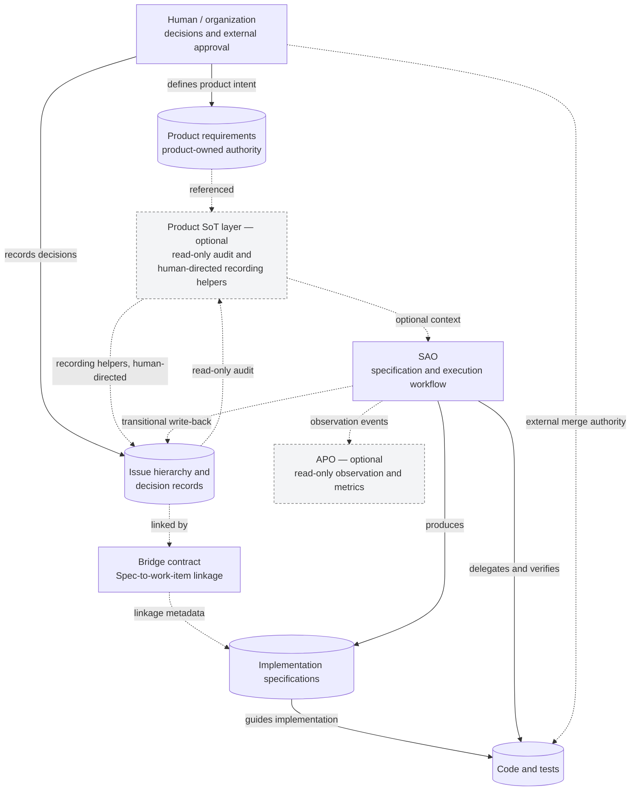

# AI Development Workflow Architecture

A technical architecture portfolio for **SAO (Spec-driven AI Orchestration)** and its optional **Product Source-of-Truth (SoT)** and observation layers. It explains how a reusable AI-assisted engineering workflow is structured, and how one adopting project adapted that workflow without exposing the project's product details.

**This repository is documentation, not a distributable implementation or an installation guide.** The application and workflow implementations are not published here.

## Architecture at a glance

The diagram separates **authority**, **execution**, and **observation**. Product meaning is owned by the adopting project; the workflow receives context through linked work items to produce implementation specifications, delegate implementation, and verify results. A Bridge defines linkage rather than executing work. The optional observation layer records engineering events without deciding what to do.

## Two views of the workflow

| View | Focus |
| --- | --- |
| **Default workflow** | A reusable, spec-driven sequence: requirements, design, tasks, implementation, verification, review, integration. |
| **Project adaptation** | A documented example of moving product authority upstream, reorganizing development stages, and verifying a shared interface contract across independently developed components. |

The adaptation is an **example**, not a recommended universal development process. Some components are reused unchanged; others are configured, extended, replaced, reorganized, or deliberately not adopted.

## Design principles

- **Authority is explicit.** Product requirements, decision history, implementation specifications, shared interface contracts, and code each have different owners.
- **Record, don't enforce approval state.** Approval fields are observed and recorded as-is; they neither gate the workflow nor prove that a human approved, because a field does not say who set it. Technical verification failures and external repository permissions remain separate concerns.
- **Delegate and verify.** A coordinating AI session delegates implementation and independent reviews, then consolidates evidence for human decisions.
- **Adopt selectively.** Optional capabilities and project-specific integrations should not be mistaken for universally active features.

## Technical highlights

- Separate product authority from AI execution artifacts.
- Consolidate findings from two independent model-based reviewers by taking a union rather than a majority vote.
- Distinguish a verifier being *defined* from it being *wired into the actual CI path*.
- Verify frontend/backend compatibility against a shared authoritative contract, even when only one side changes.
- Track locally adapted workflow components separately from upstream distribution.

## Documentation

- [Architecture and authority](docs/architecture.md)
- [Default development flow](docs/default-workflow.md)
- [Anonymized project adaptation](docs/project-adaptation.md)
- [Design decisions](docs/design-decisions.md)
- Diagram sources: [architecture](diagrams/architecture.mmd), [default flow](diagrams/default-flow.mmd), [adaptation](diagrams/adaptation-flow.mmd)

## Status and limitations

The descriptions reflect the investigated workflow state in **November 2026**. They distinguish an implemented capability from confirmed operational use. The default path assumes specific AI coding tools, not interchangeable providers. Some governance migration work remains incomplete; optional observation is not established as operating in the adopting project. The adaptation has real CI-backed contract checks, but many other declared checks are not wired into that project's CI. No quantified improvement in development speed, code quality, or cost is claimed.

Published architecture principles and an anonymized adaptation do **not** grant access to, or disclose, the private product and its internal materials. No source code, internal prompts, configuration examples, or product-specific contracts are included.
