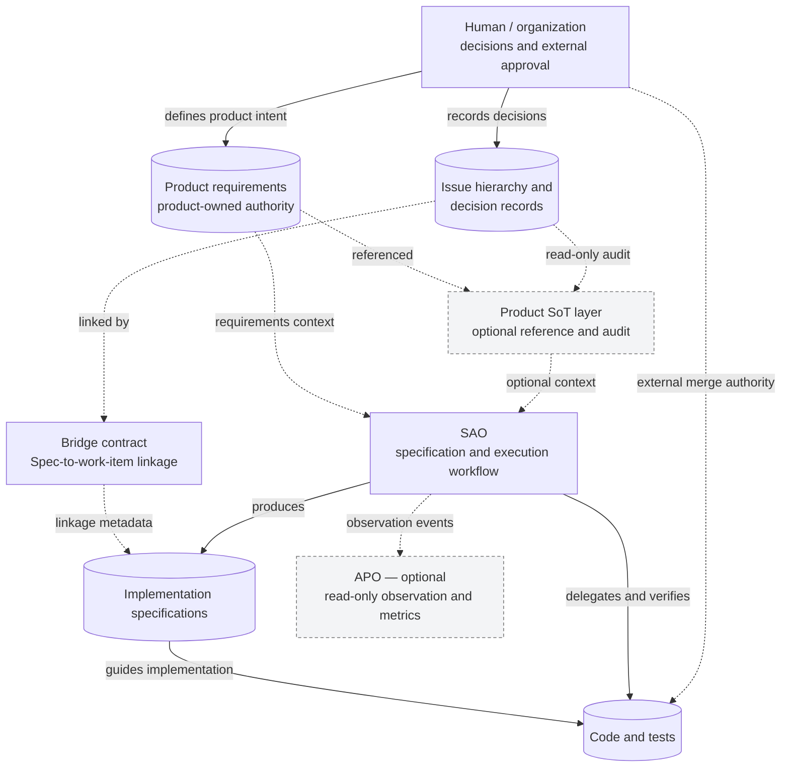

# Architecture and authority

This document describes the **logical architecture** of the default SAO distribution and its optional layers. It is not a diagram of a particular product's repositories or deployment topology. The investigated reference is the current upstream design as of November 2026; the adopting project's differences are covered separately.

## Responsibilities

| Component | Responsibility | Authority boundary | Evidence status |
| --- | --- | --- | --- |
| **Product requirements** | Define what the product means and the intended scope | Owned by the adopting project, not by SAO | Documented design |
| **Issue hierarchy and decision records** | Track work and the provenance of decisions | The issue tracker owns its own records | In operational use in the adaptation |
| **Product SoT layer** | Optionally reference, reverse-lookup, and audit upstream information | Read-only with respect to product authority; does not own product meaning | Implemented in default; adapted version has diverged |
| **Bridge contract** | Link implementation specifications to upstream work items | Defines references; does not execute workflows | Documented contract |
| **SAO** | Create implementation specifications, delegate implementation, verify changes, coordinate review and integration | Owns the execution workflow and its specification artifacts, not product meaning | Implemented |
| **APO observation** | Capture development events and derive metrics | Append-only observation, no approval or execution authority | Implemented as optional capability; live adoption unverified |
| **External human and repository governance** | Resolve product questions, select review findings, authorize sensitive changes and merges | External to the workflow's approval-state records | Documented, with observed use of external repository controls |

## Authority model

[Diagram source](../diagrams/architecture.mmd)

The important relationship is **reference, not transfer of authority**. Product meaning is not overwritten as a by-product of implementing a specification. Decisions and work items remain traceable, while implementation specifications direct coding and verification. The optional SoT layer reads and audits upstream material; the Bridge provides linkage semantics rather than an autonomous service.

The interface contract is another distinct authority in an adopting project. Its particular format is not intrinsic to SAO.

## Approval records and technical checks

Approval information is treated as an **observation**, not as a workflow-created execution gate. An automatic progression option does not imply human approval. This policy is expressed in AI instructions and should **not** be described as a mechanically guaranteed authorization boundary.

Technical failures are different: missing required specifications, unsuccessful tests, or inability to complete verification can stop a stage. Product conflicts and sensitive decisions return to the appropriate human authority. External systems retain their actual merge and access controls.

Some older approval-gate wording and write-back behavior still exist in parts of the default distribution while governance migration remains incomplete. The architecture therefore states the intended separation without claiming universal enforcement across every path.

## Verification and observation

SAO uses specification-oriented validation, traceability, and model-based review. A separate class of checks audits whether verifiers are distributed and connected to the places where they are expected to run. The distinction matters: **having a verifier, declaring a verifier, and running it in an adopting project's CI are three different facts**.

The optional APO layer receives observation events without controlling the outcome of a review or a merge. The investigated adaptation does not use APO; its operational effectiveness remains unverified.

## Deployment and portability boundary

SAO is distributed as a collection of workflow instructions, agents, skills and validation capabilities. The coordinating environment relies on **Anthropic Claude Code**, with **OpenAI Codex CLI** used for implementation and a second review stream. Model-independent orchestration remains a design aspiration, not a verified implementation property.

## Design rationale

See [Design Decisions](design-decisions.md) for the trade-offs behind recording approval states, independent review, verifier wiring checks, project-specific contract verification, and selective distribution.
