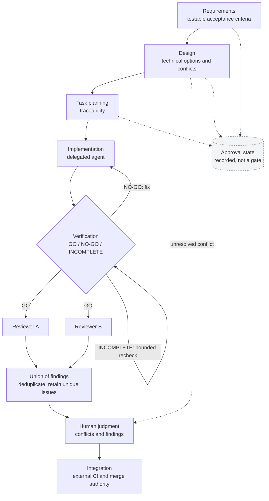

# Default development flow

This is the **default SAO workflow**, not a claim that every adopting project runs every stage or optional extension. The stage definitions are documented; selected control behaviors and agent wiring were verified against the investigated distribution.

## Standard path

[Diagram source](../diagrams/default-flow.mmd)

| Stage | Intended result | Who does the work |
| --- | --- | --- |
| **Requirements** | Testable requirements, acceptance criteria and input coverage | AI specification agent; optional human inspection |
| **Design** | Technical design, research and conflict assessment | AI agents; human resolves a material conflict |
| **Task planning** | Implementation tasks linked to requirements and tests | AI specification agent |
| **Implementation** | Code and tests informed by the specifications | Delegated implementation agent |
| **Verification** | A GO, NO-GO or INCOMPLETE finding based on available evidence | Validation agent and test environment |
| **Multi-model review** | Consolidated findings from independent review streams | Two AI reviewers; human decides which findings to adopt |
| **Integration** | Proposed change, external checks and merge decision | AI prepares and responds; repository rules and human authority govern merge |

Approval status for requirements, design, and planning may be recorded without becoming a mandatory transition gate. Missing evidence and failed technical checks remain meaningful stop conditions.

## Roles and handoffs

The **main session** coordinates stages, reads artifacts and delegates work; by policy it does not directly implement or pronounce its own review verdict. Specialized agents author specifications and execute verification. The **implementation agent** writes code within its delegated scope. Reviewers inspect the same change independently, ideally without coupling their findings to each other.

The persistent artifacts, rather than a single AI conversation's memory, carry decisions and specifications between stages. Scoped guidance supplies relevant engineering context. These are documented workflow conventions; instruction-following alone does not make them deterministic guarantees.

## Review consolidation

The review contract calls for a **union of findings**: remove duplicates but preserve findings unique to either reviewer. The higher severity is retained when reviewers disagree; lower-confidence findings are not silently discarded. A single unavailable reviewer may yield a warning, while both being unavailable returns the matter to a human.

This is a reviewed, implemented arrangement, **not** evidence that two models necessarily find more real defects. No reliable comparative detection-rate metric was available in the investigation.

## Verification outcomes

| Outcome | Meaning | Consequence |
| --- | --- | --- |
| **GO** | The required specification alignment and tests were checked successfully | Continue |
| **NO-GO** | A mismatch or failure was found | Stop and address the finding |
| **INCOMPLETE** | Required verification could not be executed or established | Retry within a bound; do not infer GO |

A design conflict requiring judgment is not the same as an unrecorded approval field. Likewise, a repository's permission to merge remains external to SAO.

## Other documented paths

The distribution also describes a shorter specification path, a defect-repair path, and optional frontend-oriented design and visual checks. These are not shown as universally active parts of the default path. Some defect-repair instructions and the main-session implementation restriction still lack an explicitly reconciled exception.

## Limitations

The standard workflow is coupled to current coding-agent tools. Some legacy governance instructions remain during migration. The existence of a validation command does not establish that it runs in an adopting project's CI; the adaptation case demonstrates why that distinction matters.
