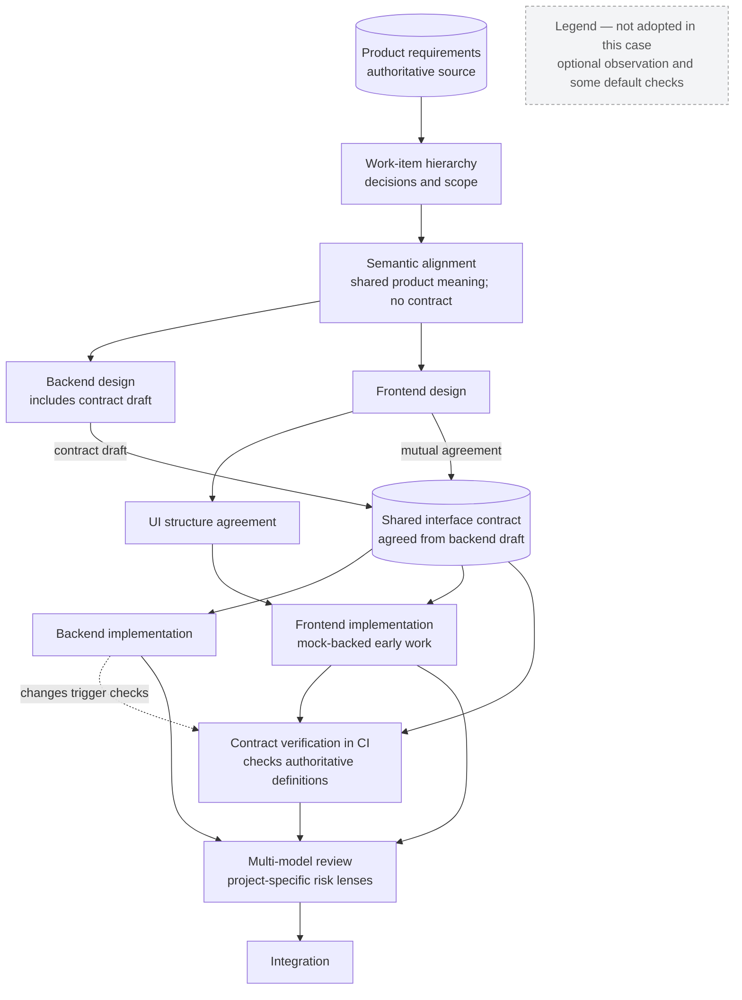

# Project adaptation: an anonymized engineering case

This case documents **workflow adaptation**, not a product architecture, business process, or implementation guide. Product identity, domain, interfaces, and internal configuration are intentionally omitted. The case illustrates an adopted configuration observed in November 2026, not a universal recommendation.

## What changed

The default workflow begins with an implementation specification. In the observed adaptation, product requirements and a tracked work hierarchy form the upstream authority; implementation specifications are derived downstream for scoped work.

Development stages were reorganized so that **frontend and backend design start independently from shared product meaning** and converge twice: a semantic alignment that creates no technical contract, and a later contract agreement based on the backend's draft. The shared interface becomes a clear integration boundary, and CI-backed checks read authoritative contract definitions rather than relying solely on a textual comparison at final integration.

## Adaptation overview

[Diagram source](../diagrams/adaptation-flow.mmd)

This is a **conceptual overlay of the changed responsibilities**. Arrows do not imply that all processing is sequential. Frontend design and implementation need not wait for backend design or implementation to be complete. Semantic alignment, UI structure agreement and contract agreement are coordination points, not claims that every project needs the same gates. The "not adopted" node is a legend, not a step in the flow.

## Differences from the default

| Concern | Default | Observed adaptation | Change |
| --- | --- | --- | --- |
| Requirements authority | Implementation-spec-first; optional upstream context | Product-owned requirements and tracked work items precede derived specs | **Replaced** |
| Development stages | General requirements, design, tasks and implementation | Reorganized design and delivery responsibilities | **Reorganized** |
| Frontend/backend coordination | General flow with optional frontend extensions | Independent design and implementation from shared product meaning; convergence at semantic alignment and at contract agreement | **Reorganized** |
| Interface verification | AI-assisted requirement/contract alignment | CI checks directly compare consumer-facing definitions with the authoritative shared contract | **Extended** |
| Engineering guidance | Scoped contextual instructions | Applicable architecture decisions are selected once at design time, recorded, and reused by later stages | **Extended** |
| Decision records | Approval fields observed and recorded | Each decision additionally records whether it originated from a human or an AI | **Extended** |
| Review | Independent model reviews | Extra risk-sensitive review perspectives for selected changes | **Extended** |
| Optional observation | Available separately | Not adopted | **Omitted** |
| Default verifier CI template | Available for adoption | Not enabled; only a subset of custom checks is active in CI | **Omitted** |
| Other workflow components | Shipped in default distribution | Many retained without changes | **Unchanged** |

The labels describe how the workflow was adapted; they are **not** new runtime states or implementation mechanisms.

## The contract verification boundary

The notable operational extension is a **source-of-contract check**: a consumer-side test reads the common contract and validates its own representations. A change on the provider side can therefore trigger a check on the consumer side, without waiting for a fully connected integration environment.

This verifies a particular interface mapping. It does **not** mean every generated type or mock definition is checked by CI; that broader coverage was not established in the investigated implementation.

## Reuse and dependency

- **Reusable principles:** authority separation, decision provenance, stage-specific verification, independent review and approval-state recording.
- **Needs integration:** scope-specific context, test execution, change-triggered CI and organization-specific approval responsibilities.
- **Depends on technical shape:** source-of-contract verification requires an authoritative machine-readable interface, though its architectural pattern is broader.
- **Specific to the adopting organization:** internal work hierarchies, review conventions and delivery practices; these details are deliberately excluded.

## Observed limitations

The adapted SoT layer remains on a locally diverged definition of what counts as its authoritative record; it has not simply tracked the current default layer. Some validators are declared or distributed but are not active in the adopting project's CI. Some opt-in extensions remain unused, and distribution/update boundaries have shown that preserving local changes and receiving upstream updates are competing concerns.

These are **limits of current implementation and adoption**, not proof that modularity or traceability has failed. Conversely, no measured causal improvement in delivery speed, cost or overall quality is claimed.
